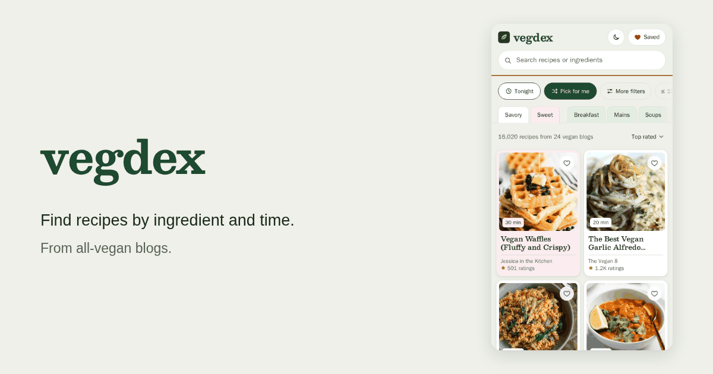

# vegdex · Vegan recipe search

Find vegan recipes by ingredient, meal or cooking time. Save the ones you like, build a shopping list, and cook from the original publisher’s instructions.

[Open vegdex](https://vegdex.antomanc.com/) · [Report a bug](https://github.com/antomanc/vegdex/issues) · [Contribute](#contributing)

[](https://github.com/antomanc/vegdex/actions/workflows/ci.yml)
[](https://github.com/antomanc/vegdex/actions/workflows/daily.yml)
[](LICENSE)

[](https://vegdex.antomanc.com/)

## What you can do

- Search recipes from all-vegan food blogs, with ingredients to use or avoid.
- Filter by cooking time, meal type and dietary preferences.
- Save recipes and turn your choices into a shopping list.
- Switch between English and Italian, and US and metric measurements.
- Use the app offline after its data has been cached.

The app runs in your browser. Every source is an all-vegan publisher, and an additional ingredient check excludes recipes that name an animal product without a plant-based qualifier. Check the original recipe for allergens: filters are derived from the available recipe data.

## Run locally

You need Node.js 22.12 or later and pnpm. The project pins pnpm in `package.json` and uses Node 24 in `mise.toml`.

```bash
git clone https://github.com/antomanc/vegdex.git
cd vegdex
corepack enable
pnpm install --frozen-lockfile
pnpm fixtures
mkdir -p apps/web/public/data
cp -R e2e/fixtures/data/. apps/web/public/data/
pnpm dev
```

Open the address printed by Vite. The fixture dataset is small and intended for development and tests. To use the full dataset, download the crawl store from the [data release](https://github.com/antomanc/vegdex/releases/tag/data), then emit it:

```bash
mkdir -p .data
gh release download data --repo antomanc/vegdex --pattern store.json.gz --dir .data
pnpm ingest emit
```

The [GitHub CLI](https://cli.github.com/) is needed for that download. Alternatively, download `store.json.gz` from the release page into `.data/`.

## How the index works

A GitHub Actions workflow crawls the configured sources daily, extracts recipe JSON-LD, checks ingredients and emits static data for the web app. The crawler identifies itself, respects `robots.txt` and crawl delays, and makes at most one request per second per site. After the first crawl it fetches pages that are new or changed. It does not work around sites that block it.

vegdex stores recipe facts such as titles, ingredient lines, times, servings, ratings, nutrition and image URLs. It does not store cooking methods or the publisher's writing. Images load from the publisher, and recipe links lead to the original instructions.

Ingredient translations are composed from the vocabulary in `packages/ingest/data/vocab/`. Lines that cannot be composed stay as written; commentary is omitted. See [ADR 0005](docs/adr/0005-vocabulary-in-git-filled-by-any-worker.md) and the [vocabulary guide](docs/agents/vocabulary.md).

The metric switch uses the publisher's gram measurements when available. Liquids such as water, broth, plant milk and oil are shown in ml. Other cup measures are estimated in grams from a table based on USDA FoodData Central and the King Arthur Baking ingredient weight chart; estimates are marked `≈`. Spoons and whole items stay as written.

The public site counts visits with Cloudflare Web Analytics, which sets no cookies. The deploy adds it only when the `CF_ANALYTICS_TOKEN` repository variable is set.

## Development

| Path | Contents |
| --- | --- |
| `apps/web` | Svelte 5 and Vite web app |
| `packages/core` | Shared recipe types, parsing, search, vegan checks and shopping-list calculations |
| `packages/ingest` | Crawler, source list and dataset emitter |
| `e2e` | Playwright tests and fixture dataset |

```bash
pnpm build                  # build the web app
pnpm typecheck              # check workspace and e2e types
pnpm test                   # Vitest
pnpm test:e2e               # Playwright with fixture data
pnpm knip                   # check unused files, exports and dependencies
pnpm ingest run             # crawl and emit
pnpm ingest run --pull      # start from the store the daily workflow saved, then crawl and emit
pnpm ingest emit            # emit from the local crawl store
pnpm ingest crawl --sources <id> --max-per-source 30   # crawl one source on demand
pnpm coverage               # translation coverage and gaps
```

Playwright needs a Chromium installation; run `pnpm exec playwright install chromium` if it is missing. See the [testing guide](docs/agents/testing.md) for the full checks and [local model fills](docs/local-model-fills.md) for vocabulary work.

The crawl store is kept in the `data` release, outside git. Ingest writes vegan-check rejections to `.data/excluded.json` and held recipes to `.data/held.json`.

## Contributing

Issues and pull requests are welcome. For a bug report, include the steps to reproduce it and, if relevant, the recipe URL. For a change, run the checks in the [testing guide](docs/agents/testing.md).

To suggest a source, open an [issue](https://github.com/antomanc/vegdex/issues). Every recipe on the source must be vegan. To test one locally, add it to `packages/ingest/sources.json`, then run:

```bash
pnpm ingest crawl --sources <id> --max-per-source 30
pnpm ingest emit
```

Review the output and `.data/excluded.json`. Set `contentLanguage` to `it` for original Italian publishers; it defaults to `en`. Each content language needs a tested language pack and vocabulary. Non-English recipes with unmapped ingredients are held until the vocabulary maps them; translated editions of existing publishers are excluded.

## License

The code is licensed under [MIT](LICENSE). Recipes, photos and their text belong to their respective publishers.
